<a href="https://abhivir.xyz">
  <picture>
    <source media="(prefers-color-scheme: dark)" srcset="assets/sonar-dark.svg">
    
  </picture>
</a>

  <a href="https://github.com/abhivirchaudhary/begone"><picture><source media="(prefers-color-scheme: dark)" srcset="assets/key-begone-dark.svg"></picture></a>
  &nbsp;
  <a href="https://github.com/abhivirchaudhary/Reperio"><picture><source media="(prefers-color-scheme: dark)" srcset="assets/key-reperio-dark.svg"></picture></a>
  &nbsp;
  <a href="https://abhivir.xyz"><picture><source media="(prefers-color-scheme: dark)" srcset="assets/key-site-dark.svg"></picture></a>

